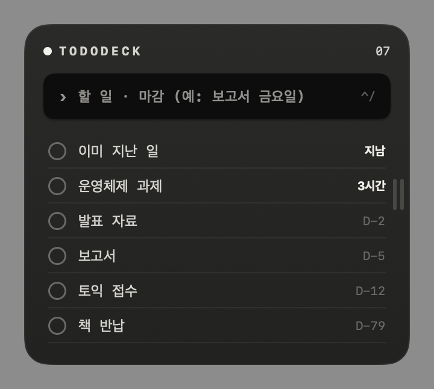
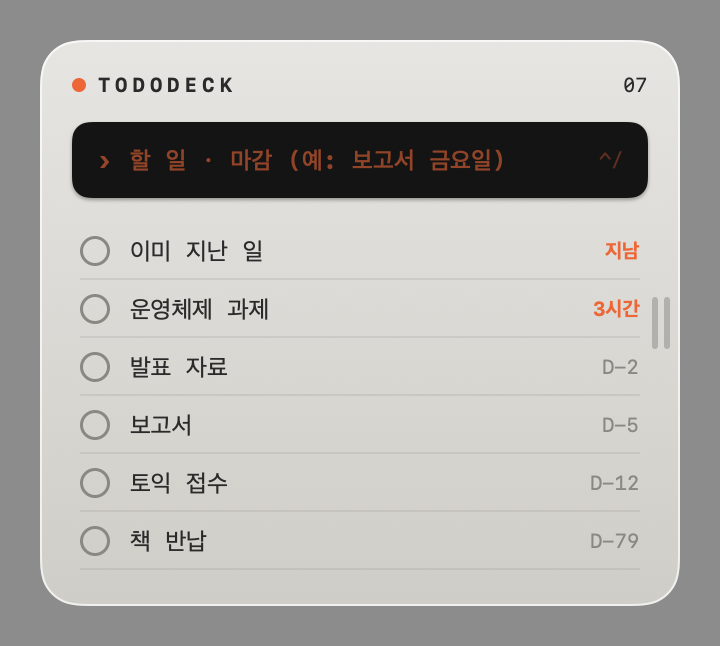

# TodoDeck

바탕화면에 놓이는 작은 할 일 기기. 어디서든 `⌃/`를 누르면 튀어나와서 바로 적을 수 있고, 마감까지 남은 시간을 보여준다.

<p>
  
  
</p>

## 기능

- **전역 단축키 `⌃/`** — 어떤 앱을 쓰고 있든 튀어나와 입력칸에 커서가 간다. 한 번 더 누르면 들어가고 원래 쓰던 앱으로 돌아간다. `ESC`도 닫기.
- **한국어로 마감 적기** — 끝에 붙이면 마감으로 인식한다.
  - `보고서 금요일까지` · `과제 10/25 18시` · `발표 다음주 화요일 오후 3시` · `장보기 3일 후` · `운동 6시반`
- **남은 시간** — `D-3`, `5시간`, `45분`, `지남`. 하루 안 남은 일은 강조된다. 마감 가까운 순으로 정렬.
- **체크** — 줄이 그어진 채 맨 아래로 내려가고, 다음 날 자동으로 정리된다. 우클릭 › "완료한 일 지우기"로 바로 정리.
- **화면 끝에 숨기기** · **테마**(라이트 / 무광 블랙) — [MusicDeck](https://github.com/Seon-e3/MusicDeck)과 같은 동작.

할 일은 `~/Library/Application Support/TodoDeck/todos.json`에 저장된다.

## 빌드

```bash
./build.sh && open TodoDeck.app
```

마감 해석 테스트:

```bash
swift test
```
